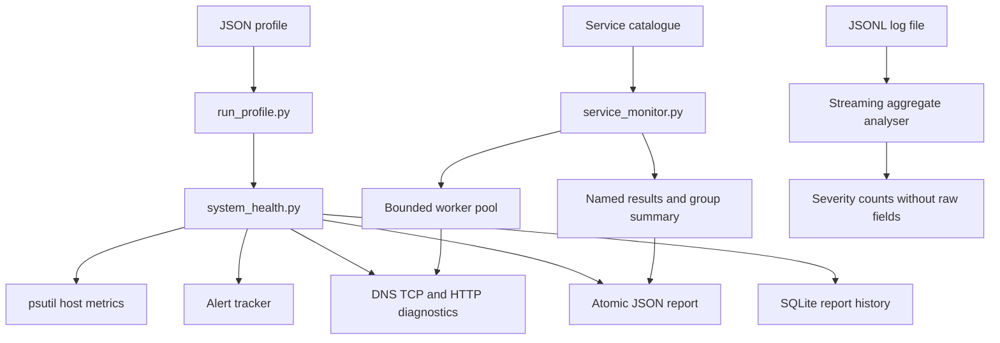

# Architecture and boundaries

The application consists of finite command-line tools. There is no resident daemon, scheduler, web dashboard or remote backend.

## Execution paths

- `run_profile.py` validates profile options before delegating to the host monitor. Validation-only mode stops before monitoring.
- `system_health.py` collects resource samples sequentially, tracks alerts in memory, then checks configured network dependencies sequentially. It reports the final resource state and all recorded alert transitions.
- `service_monitor.py` validates the entire catalogue, optionally filters a group, then uses at most 16 worker threads. Results retain catalogue order regardless of completion order. It does not collect host metrics.
- DNS and HTTP checks use subprocesses so their blocking operations can be bounded without leaving resolver threads running indefinitely. Process startup and cleanup add overhead.
- `log_analyzer.py` reads a finite JSONL file in bounded line chunks and emits aggregate counts. It is not a tailer.

## State and persistence

Alert state lasts for one invocation. JSON output uses a unique temporary file, flush and replacement. Concurrent successful writers use last-replacement-wins semantics; persistent conflicts return an error. This is not an event queue.

SQLite insertion and retention share one transaction. History is a final report per invocation, not a complete sample time series. JSON and SQLite writes are separate operations and are not jointly atomic. Record-count retention does not guarantee a fixed file size.

## Security and operational boundaries

HTTP checks use default HTTPS verification and never follow redirects. They do not authenticate users, inspect page content or prove browser behaviour. GET endpoints must be safe to call repeatedly.

Profiles and catalogues can select local file destinations and reachable network targets; treat them as trusted operational inputs. Report payloads may contain hostnames and addresses. The tools do not encrypt local files or enforce repository access policies. The log summary excludes arbitrary fields rather than claiming complete secret redaction of messages.

## Current tradeoffs

The project is a diagnostic prototype. There is no catalogue-wide deadline, retry policy for probes, automatic remediation, long-term service availability calculation or distributed collector protocol. Evaluate OpenTelemetry interoperability and actual operator feedback before adding these capabilities.
